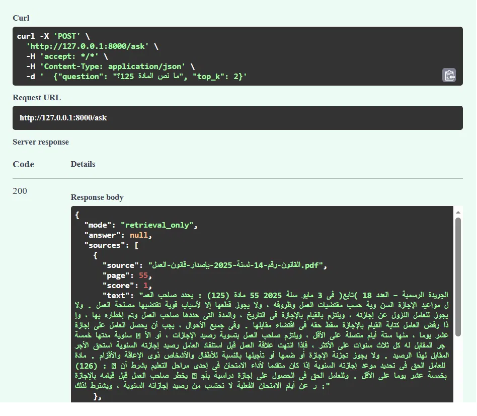
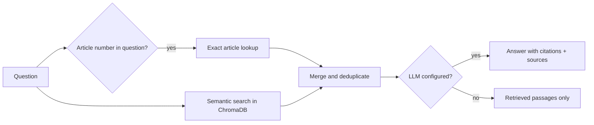

# Daliil

A multilingual document Q&A API built with **FastAPI**, **ChromaDB**, and **Sentence Transformers**.

Upload PDF, TXT, or Markdown files, ask questions in Arabic, and get the most relevant passages back with their source file and page number. If an LLM is configured, Daliil also generates a short answer grounded in those passages.

It was developed and tested mainly on Arabic legal text (the Egyptian Labor Law, 2025), which is why it includes Arabic PDF cleanup and exact lookup of numbered articles.

## Features

- Upload and index PDF, TXT, and Markdown documents.
- Semantic search with multilingual embeddings (`intfloat/multilingual-e5-small`).
- Exact lookup for Arabic legal articles (for example `ما نص المادة 150؟`), because embeddings are weak at matching numbers.
- Arabic PDF cleanup: presentation-form letters, split letters, digit normalization, and an optional fix for reversed number runs.
- Source-grounded answers with citations, using any OpenAI-compatible LLM endpoint.
- Retrieval-only mode when no LLM is configured.
- Endpoints for listing, deleting, and resetting indexed documents.



*Response of `/ask` for "ما نص المادة 125؟" in retrieval-only mode: each result has its source file, page number, and score.*

## How It Works



1. **Upload:** extract text from the file and clean Arabic extraction issues.
2. **Chunk:** split the text into overlapping word-based chunks (200 words, 40 overlap by default).
3. **Index:** embed the chunks and store them in ChromaDB with source, page, and chunk number.
4. **Retrieve:** run semantic search. If the question names an article, add the exact match (and the chunk after it, since articles often span two chunks) in front of the results.
5. **Answer:** if an LLM is configured, generate a short answer using only the retrieved passages.

## Evaluation

Retrieval was evaluated on the Egyptian Labor Law (2025): 112 pages, 298 articles, run locally in retrieval-only mode.

**Article-number questions** (30 random articles, question: `ما نص المادة N؟`)

| | Hit@1 | Hit@4 |
|---|---|---|
| Semantic search only | 10% (3/30) | 23% (7/30) |
| Semantic search + exact lookup | 100% (30/30) | 100% (30/30) |

**Natural-language questions** (20 questions written from 5 sampled pages, searched over the full index)

| | Hit@1 | Hit@4 |
|---|---|---|
| Semantic search + exact lookup | 65% (13/20) | 90% (18/20) |

Average response time was about 30 ms per query on a local machine (retrieval only, no LLM call).

How to read these numbers:

- A "hit" means the retrieved passages contain the expected text, so this measures retrieval only, not the quality of generated answers.
- The exact lookup is built for article-number questions, so the first table shows what that feature adds. It is not an overall accuracy figure.
- The 20 natural-language questions are a small set. The two misses were a general question where related passages ranked higher, and a question phrased differently from the article text. Embedding scores were close together (about 0.85 to 0.87), so ranking is fragile without a reranker.

### Reproduce the results

The law itself is not included in this repository. Download Law No. 14 of 2025 (Official Gazette, issue 18, 3 May 2025) from the [Ministry of Labour website](https://www.labour.gov.eg/media/0iedik3q/%D8%A7%D9%84%D9%82%D8%A7%D9%86%D9%88%D9%86-%D8%B1%D9%82%D9%85-14-%D9%84%D8%B3%D9%86%D8%A9-2025-%D8%A8%D8%A5%D8%B5%D8%AF%D8%A7%D8%B1-%D9%82%D8%A7%D9%86%D9%88%D9%86-%D8%A7%D9%84%D8%B9%D9%85%D9%84.pdf) and save it as `law.pdf` in the project root.

1. Start the API and index the file (the `reverse_digits` option was needed for this PDF):

   ```bash
   uvicorn main:app
   curl -X POST "http://127.0.0.1:8000/ingest?reverse_digits=true" -F "file=@law.pdf"
   ```

2. Run the article test with the lookup enabled:

   ```bash
   python evaluation/test_articles.py law.pdf with_lookup rev
   ```

3. Restart the API with the lookup disabled and run it again:

   ```bash
   # Linux / macOS
   DISABLE_ARTICLE_LOOKUP=1 uvicorn main:app

   # Windows PowerShell
   $env:DISABLE_ARTICLE_LOOKUP="1"
   uvicorn main:app
   ```

   ```bash
   python evaluation/test_articles.py law.pdf without_lookup rev
   ```

4. Run the natural-language test (the questions are written for the Labor Law):

   ```bash
   python evaluation/test_semantic.py
   ```

Run the scripts from the project root. For the cleanest timing, leave `LLM_MODEL` unset so only retrieval is measured, and use `127.0.0.1` instead of `localhost`, which adds about two seconds per request on some Windows setups.

## Tech Stack

- Python
- FastAPI
- ChromaDB
- Sentence Transformers (`intfloat/multilingual-e5-small`)
- pypdf
- OpenAI-compatible LLM API (optional)

## Getting Started

### 1. Clone the repository

```bash
git clone https://github.com/ahmedshahin12347/daliil.git
cd daliil
```

### 2. Create and activate a virtual environment

**Windows (PowerShell):**

```powershell
python -m venv .venv
.venv\Scripts\Activate.ps1
```

**Linux / macOS:**

```bash
python -m venv .venv
source .venv/bin/activate
```

### 3. Install dependencies

```bash
pip install -r requirements.txt
```

### 4. Configure environment variables

Copy `.env.example` to `.env` and adjust it.

| Variable | Default | Description |
|---|---|---|
| `EMBED_MODEL` | `intfloat/multilingual-e5-small` | Embedding model |
| `CHROMA_DIR` | `./chroma_db` | Local vector database directory |
| `CHUNK_WORDS` | `200` | Words per chunk |
| `CHUNK_OVERLAP` | `40` | Overlap between chunks |
| `TOP_K` | `4` | Passages to retrieve |
| `LLM_BASE_URL` | not set | Base URL of an OpenAI-compatible API |
| `LLM_API_KEY` | `none` | API key for the LLM provider |
| `LLM_MODEL` | not set | Model name used for answer generation |
| `DISABLE_ARTICLE_LOOKUP` | not set | Set to `1` to turn off exact article lookup (used for evaluation) |

LLM settings are optional. To enable generated answers, set `LLM_BASE_URL` and `LLM_MODEL`.

**Security:** never commit your real `.env` file or API keys.

### 5. Run the API

```bash
uvicorn main:app --reload
```

Interactive API docs: **http://127.0.0.1:8000/docs**

## API Endpoints

| Method | Endpoint | Description |
|---|---|---|
| `GET` | `/health` | Service status, indexed chunk count, and mode (`rag` or `retrieval_only`) |
| `GET` | `/documents` | List indexed document filenames |
| `POST` | `/ingest` | Upload and index a PDF, TXT, or Markdown file. Optional query parameter `reverse_digits=true` for PDFs whose number runs come out reversed |
| `POST` | `/ask` | Ask a question and get relevant passages (and an answer if an LLM is configured) |
| `DELETE` | `/documents/{source}` | Delete one document from the index |
| `DELETE` | `/documents` | Clear the whole index |

### Example: ask a question

`POST /ask`

```json
{
  "question": "ما نص المادة 150؟",
  "top_k": 4
}
```

The response contains the mode, the retrieved passages with their source file, page number, and similarity score, and a generated answer when an LLM is configured. Re-uploading a file with the same name replaces its old version in the index.

Results found by the exact article lookup always have a score of 1.0. The semantic results that follow carry their real cosine similarity.

## Project Structure

```
daliil/
├── main.py                  # API, indexing, retrieval, article lookup
├── evaluation/
│   ├── test_articles.py     # article-number questions
│   └── test_semantic.py     # natural-language questions
├── requirements.txt
├── .env.example
└── .gitignore
```

## Limitations

- Scanned PDFs are not supported because there is no OCR.
- Chunking is based on word counts, so a chunk can end in the middle of a sentence or article.
- There is no reranker or similarity threshold, and ranking is weak for general questions (Hit@1 of 65% on the small test set).
- Exact lookup expects Arabic phrasing such as `المادة 150` and headings in the form `مادة (150) :`. It has only been tested on one law.
- Evaluation covers retrieval only. The quality of LLM-generated answers has not been measured.
- The test sets are small and written for a single document.

## Future Improvements

- Chunk by article instead of by word count.
- Add a reranking model.
- Evaluate generated answers, not only retrieval.
- Test on more documents and a larger question set.
- Support OCR for scanned PDFs.
- Add Docker support and automated tests.
